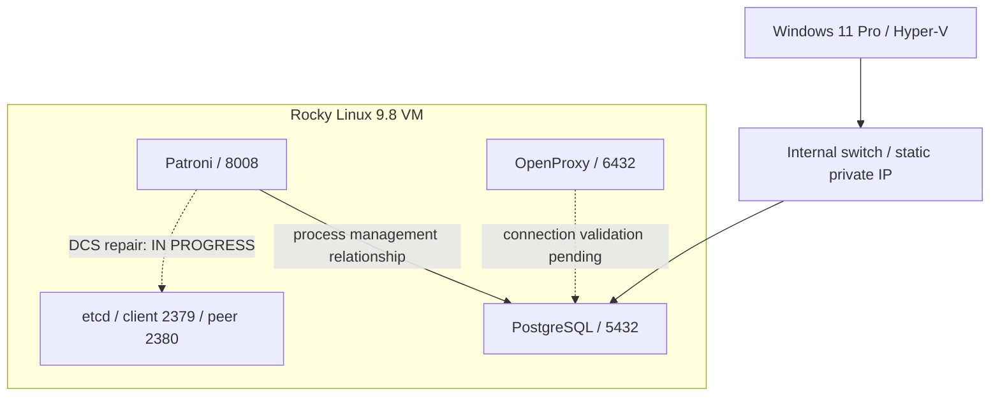

# OpenSQL Lab ? Evidence v0.1

**Status:** operator-executed personal lab; Patroni DCS RCA **IN PROGRESS**.
**Record cutoff:** 2026-10-14 KST.
**Independent upstream-only reproduction:** **NOT EXECUTED**.

I installed Tmax OpenSQL 3.17.11.7 on a local Rocky Linux VM and investigated
control-plane connection failures after changing its address. Before migrating
etcd endpoints, I saved a snapshot; I then updated the existing member's peer
URL and service configuration. The recorded checks showed an active etcd
service, a successful local health response, updated peer/client URLs, and
the same member ID before and after the change.

These checks establish progress on the etcd migration. Post-change Patroni
DCS connection and Leader validation, OpenProxy connectivity, and a full VM
reboot check remain incomplete.

## Scope and evidence standard

This is a desktop learning environment, separate from customer PoC or production
support. It demonstrates investigation and bounded verification, not
multi-node HA, failover, or production PostgreSQL ownership.

The work was executed manually by the operator. This PR documents the results;
it did not execute installation, restart services, or re-run the lab.
[EVIDENCE.md](EVIDENCE.md) identifies each claim as:

- **RECORDED:** an observation or command result preserved in the operator's
  terminal/work records, sometimes available only as a retrieved summary.
- **REPORTED:** completion stated by the operator, with supporting procedural
  details still missing.
- **REFERENCE:** general upstream behavior, not evidence of a local execution.

Full original logs are not attached in v0.1. Transcribed values and redacted
command shapes are explicitly labeled; missing outputs are not reconstructed.

## Environment

| Component | Recorded environment | Limit |
|---|---|---|
| Desktop host | Windows 11 Pro, 64-bit, approximately 32 GB RAM | Host repair was a setup task |
| Virtualization | Hyper-V | One local VM |
| Guest OS | Rocky Linux 9.8 | Personal lab environment, not a vendor certification claim |
| Product package | Tmax OpenSQL 3.17.11.7 | No proprietary installer or payload distributed |
| PostgreSQL engine | Present; local port 5432 readiness recorded | Exact embedded version not captured in the available record |
| Patroni | Initial pre-migration Leader/running recorded | Exact installed version unconfirmed; post-migration Leader unverified |
| etcd | Server version 3.6.0 recorded during snapshot save | One member in this lab |
| OpenProxy | Present in the installation | Address change and connection validation pending |
| Network | Hyper-V Internal Switch with a static private guest address | Gateway, NAT, and broader reachability are not asserted |

The available archive's filename targeted Rocky Linux 9.7; the actual guest was
9.8. Installation success does not establish official support for that
combination. The product package number does not identify the embedded
PostgreSQL major version.

## Architecture

This sketch shows component relationships. Dashed connections require
post-migration validation; the diagram is not a claim that every path is healthy.

Actual addresses, host/member names, member ID, installation paths, and
configuration contents are withheld. `OLD_DHCP_IP`, `NEW_STATIC_IP`, and
`MEMBER_ID` are symbolic labels.

## Investigation and findings

### 1. Windows / Hyper-V management tools

**Symptom:** optional-feature state was Enabled, while the management console
file was not found and the Hyper-V PowerShell module could not be loaded.

**Diagnosis:** checked the file path, searched its system directory, tested
module loading, and verified that PowerShell itself was 64-bit. Disabling and
re-enabling management tools with intervening reboots did not restore the
console. DISM ScanHealth subsequently reported a repairable component store.

**Action and validation:** the later operator record reports successful DISM
RestoreHealth, an SFC check without integrity violations, and the management
console opening after reboot. Windows setup recovery is complete in the
operator record (H01).

**Cause boundary:** component-store damage was detected. The exact damaged
package/files and the complete causal chain to the missing console were not
identified in the published evidence.

### 2. Installation prerequisites and SFCGAL

**Symptom:** installation encountered missing required packages and rejected
the installed SFCGAL 1.5.0 package against a minimum requirement of 2.0.0.
The recorded package listing showed only 1.5.0 in the queried EPEL source.

**Diagnosis:** distinguished a missing dependency from an available package
whose version did not meet the installation requirement.

**Outcome:** the operator reports resolution of the prerequisite blockers,
and the later installation record reports local single-node installation
complete (I01/I02). Before the address change, Patroni showed Leader/running.

**Evidence gap:** the exact missing-package list and the SFCGAL remedial action
are not available. v0.1 does not claim that SFCGAL was upgraded to 2.0,
built from source, that a prerequisite check was bypassed, or that GIS
functionality was validated. This is completed installation with an incomplete
remediation record, not a published reproducible dependency-resolution recipe.

### 3. Static address change and Patroni DCS failure ? IN PROGRESS

**Trigger:** moved the VM from its initial DHCP address to a static address
on an Internal Switch.

**Symptom:** Patroni connection attempts timed out against
`OLD_DHCP_IP:2379`. PostgreSQL accepted local connections on port 5432.

**Diagnosis:** searched the relevant configuration files and found old-address
references in Patroni, OpenProxy, and etcd configuration. Local database
readiness was checked separately from control-plane connectivity (N01/P01).

**Finding:** stale configured endpoints are a demonstrated contributor to the
observed Patroni failure. The full RCA is **IN PROGRESS** until corrected
Patroni DCS connectivity and a current Leader result are captured. The
pre-migration Leader observation does not close the post-migration incident.

### 4. etcd snapshot and existing-member endpoint migration

**Recorded action sequence:**

1. Saved an etcd snapshot and backed up the relevant configuration files.
2. Updated the existing member's peer URL with `etcdctl member update`.
3. Applied updated etcd service configuration and restarted the etcd service.
4. Checked service activity, local health, published peer/client URLs, and
   identity before/after (E01?E03).

**Recorded result:** service `active`; member `started`; local health
`{"health":"true","reason":""}`; peer/client URLs using `NEW_STATIC_IP`;
the same member ID before and after migration.

This verifies the recorded etcd checks. Saving a snapshot is not a tested
restore. Member-ID equality is not proof of keyspace/data integrity, successful
Patroni reconnection, proxy routing, or resilience after a VM reboot.

## General technical explanation ? REFERENCE

etcd distinguishes listening endpoints from addresses advertised to clients
and peers [R1]. Peer-URL changes require a membership update before restarting
the member; updated advertised client URLs are published on restart [R2].
A successful local etcd check does not verify another process's configured
destination.

Snapshot save and snapshot restore are separate operations. An etcd snapshot
restore creates a new logical cluster and rewrites identity metadata [R3].
This lab records an existing-member endpoint update and identity comparison;
it does not claim a disaster-recovery restore.

Patroni's DCS connection settings must match its intended etcd endpoint and API
configuration [R4]. No change of the lab's DCS API mode is claimed here.

## Validation at the v0.1 cutoff

| Item | Status | Evidence |
|---|---|---|
| Windows/Hyper-V setup recovery | Completed in operator record | H01 |
| Rocky Linux 9.8 VM and OpenSQL single-node install | Completed in operator record | I01 |
| Prerequisite blocker resolution | Reported complete; detailed remediation missing | I02 |
| Static private addressing | Configured in operator record | N01 |
| Patroni stale-endpoint diagnosis | Finding recorded; RCA IN PROGRESS | P01 |
| etcd snapshot save | Saved; restore not tested | E01 |
| etcd peer/client endpoint change | Recorded after migration | E02 |
| etcd local health and member-ID continuity | Recorded after migration | E03 |
| Patroni DCS recovery and current Leader | IN PROGRESS | Pending |
| OpenProxy address and connection | IN PROGRESS | Pending |
| All services after VM reboot | IN PROGRESS | Pending |
| Independent upstream PostgreSQL/Patroni/etcd reproduction | NOT EXECUTED | Planned |

See [EVIDENCE.md](EVIDENCE.md) for provenance and
[FOLLOW_UP.md](FOLLOW_UP.md) for v0.2 acceptance criteria.

## Existing work and next stage

[PR #1: PostgreSQL Lock Contention RCA Lab](https://github.com/jinwon-lee-reliability/database-reliability-portfolio/pull/1)
was inspected and remains a separate open draft at this cutoff. This addition
does not duplicate its SQL, runner, Compose files, or CI evidence. Its
PostgreSQL version does not establish this package's embedded version.

The existing proposal for a multi-node Patroni/etcd HA and failover lab remains
a separate future stage. A single VM with Patroni and etcd does not complete
that proposal.

## Public-content boundary

Included: observations, bounded findings, anonymized command shapes, upstream
references, and outstanding validation criteria.

Excluded: license XML, passwords, tokens, keys, proprietary binaries,
installer archives/scripts/internal files, original service/configuration
files, snapshots, database contents, unreviewed raw logs, and customer data.
The local ignore rules are a guardrail; every future addition still requires
content review.

## References

Official documentation supports the general explanation, not the local
execution claims. Consult the installed-version documentation before reusing
any procedure.

- [R1 ? etcd 3.6 configuration options](https://etcd.io/docs/v3.6/op-guide/configuration/)
- [R2 ? etcd 3.6 runtime reconfiguration](https://etcd.io/docs/v3.6/op-guide/runtime-configuration/)
- [R3 ? etcd 3.6 disaster recovery](https://etcd.io/docs/v3.6/op-guide/recovery/)
- [R4 ? Patroni YAML configuration](https://patroni.readthedocs.io/en/latest/yaml_configuration.html)
- [R5 ? Microsoft: Windows image repair](https://learn.microsoft.com/en-us/windows-hardware/manufacture/desktop/repair-a-windows-image?view=windows-11)
