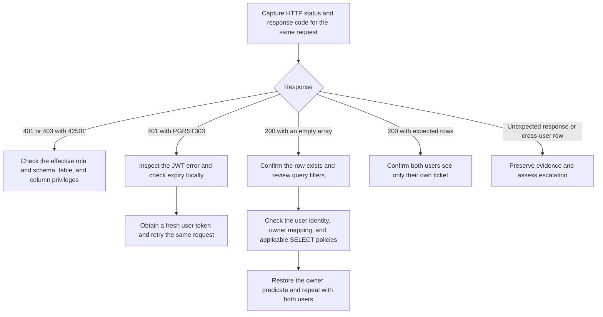

# Supabase Support Lab #1 — Auth, Data API, and PostgreSQL RLS

Independent product lab on Supabase Cloud Free using two synthetic Auth accounts and the `public.support_tickets` table. The exercise traced a denied anonymous request, a controlled loss of row visibility for signed-in users, and a separate expired-token error.

## Incident Summary

| Signal | Lab observation | Investigation layer |
| --- | --- | --- |
| HTTP 401 with SQLSTATE `42501` | An anonymous Data API read was denied. | PostgreSQL privileges for the effective role. |
| HTTP 200 with `[]` | An authenticated read returned no rows after the read policy was changed to `USING (false)`. | PostgreSQL RLS and row visibility. |
| `PGRST303` | An expired access token was rejected. Signing in again restored access. | JWT claims validation. The code can also cover other claims errors. |

## Impact

The restrictive policy hid the expected ticket rows from signed-in lab users. A client that checks only HTTP status could display an empty ticket list even though the rows still exist. The anonymous denial was consistent with the lab's intended signed-in-only access model. The scope was a Free project with synthetic data and two test identities.

## Timeline

The sequence below comes from the operator's lab observations. Exact times and elapsed durations are unavailable.

| Step | Observation or action |
| --- | --- |
| 1 | Created a Supabase Cloud Free project, two Auth users, and a `support_tickets` table. Signed in to obtain user JWTs. |
| 2 | Sent an anonymous REST request and observed HTTP 401 with SQLSTATE `42501`. |
| 3 | Granted table `SELECT` to `authenticated` and applied a per-user RLS policy. User A could read only ticket `1` and User B only ticket `2`. |
| 4 | Changed the read predicate to `false` and observed HTTP 200 with `[]`. Located the corresponding HTTP request in API Gateway logs. |
| 5 | Restored the working policy and verified visibility again with both identities. |
| Separate observation | Saw `PGRST303` on an expired JWT. A fresh sign-in restored access. |

## Troubleshooting Decision Tree



Use the UTC window, HTTP method, path, and status to find the request in API Gateway logs. Match a request identifier when available. The Gateway record corroborates the HTTP event. Inspect grants and policy definitions separately to establish what PostgreSQL evaluated.

## Root Cause, Remediation, and Validation

1. **Anonymous access.** `42501` identifies insufficient PostgreSQL privilege. The first response is consistent with an anonymous caller lacking the required table access. The original privilege snapshot is unavailable, so the response alone cannot identify every missing privilege. The lab enabled signed-in access with `GRANT SELECT` to `authenticated` and scoped row visibility by owner.
2. **Signed-in reads.** Changing the applicable read policy to `USING (false)` made every row fail the predicate while the role retained `SELECT`. The request succeeded and returned no rows. Restoring the working per-user predicate resolved the controlled failure with RLS still enabled.
3. **Expired session.** The separate `PGRST303` observation occurred with an expired JWT. A fresh sign-in resolved it. The response message and session context matter because `PGRST303` covers JWT claims validation or parsing failures more broadly.

| Check | Recorded result |
| --- | --- |
| Anonymous request | HTTP 401 and `42501`. |
| Normal policy | User A saw only `1`. User B saw only `2`. |
| Policy set to `false` | HTTP 200 and `[]`. Matching HTTP event found in API Gateway logs. |
| Policy restored | A/B reads again showed only their respective tickets. |
| Expired JWT | `PGRST303` observed. Fresh sign-in restored access. |

The table records operator observations. Raw responses, original logs, and request timestamps are unavailable here. The examples below reconstruct the setup and calls for a fresh project.

## Reproduce in a Disposable Project

Create two confirmed test identities in Supabase Auth and sign each one in to obtain a user access token. `user-a@example.test` and `user-b@example.test` are example aliases. Use the Auth user UUIDs from your own project in the SQL and keep them local. Use a project with the Data API enabled and `public` exposed.

### 1. Seed a table and reproduce the anonymous denial

Run this block as the table owner in the disposable project's SQL Editor. Replace both UUID placeholders before running it. It creates a new table and will fail if `public.support_tickets` already exists.

```sql
begin;

create table public.support_tickets (
    id integer primary key,
    owner_id uuid not null references auth.users (id)
);

alter table public.support_tickets enable row level security;
revoke all privileges on table public.support_tickets from public, anon, authenticated;

insert into public.support_tickets (id, owner_id) values
    (1, '<USER_A_UUID>'::uuid),
    (2, '<USER_B_UUID>'::uuid);

commit;
```

Run `ticket_read` without a bearer token using the helper below. Expect HTTP 401 with `42501` for the anonymous read in this setup.

### 2. Establish a signed-in baseline

```sql
begin;

grant select on table public.support_tickets to authenticated;

create policy read_own_ticket on public.support_tickets
    for select to authenticated
    using (owner_id = (select auth.uid()));

commit;
```

Run `ticket_read a` and `ticket_read b` with separate access tokens. The request selects only `id`. Expected bodies are `[{"id":1}]` and `[{"id":2}]`, respectively.

### 3. Reproduce the empty result and restore

Apply this change only to the disposable lab table.

```sql
alter policy read_own_ticket on public.support_tickets using (false);
```

Repeat a signed-in read with a valid token. Expect HTTP 200 and `[]`. In Supabase Logs, filter API Gateway events to `GET /rest/v1/support_tickets` and the test window. Record the status and any request identifier privately.

Restore the original predicate and repeat the A/B reads.

```sql
alter policy read_own_ticket on public.support_tickets
    using (owner_id = (select auth.uid()));
```

To check a privilege or policy mismatch, inspect the current state in the SQL Editor. Use the actual REST request for per-user validation because the table owner normally bypasses RLS.

```sql
select has_table_privilege('anon', 'public.support_tickets', 'SELECT') as anon_select,
       has_table_privilege('authenticated', 'public.support_tickets', 'SELECT') as authenticated_select;

select policyname, roles, cmd, qual
from pg_policies
where schemaname = 'public' and tablename = 'support_tickets';
```

### Safe REST calls

Use Bash and curl in a private terminal. Copy the project URL and **publishable** key from your lab. For the A/B checks, use each signed-in session's **access token**, which is available through [Supabase Auth sign-in](https://supabase.com/docs/reference/javascript/auth-signinwithpassword). Keep the session and its credentials out of console logs and source files. The helper prompts without echo and passes credential headers over standard input. It prints the HTTP status and body locally for inspection.

```bash
set +x

ticket_read() {
  local lab_url lab_key access_token=''
  local user_label=${1:-}

  read -r -p 'Lab HTTPS URL: ' lab_url || return 1
  lab_url=${lab_url%/}
  if [[ ! $lab_url =~ ^https://[a-z0-9-]+\.supabase\.co$ ]]; then
    printf 'Enter the HTTPS URL of your hosted Supabase lab.\n' >&2
    return 2
  fi

  read -r -s -p 'Lab publishable key: ' lab_key || return 1
  printf '\n' >&2
  if [[ ! $lab_key =~ ^sb_publishable_[A-Za-z0-9_-]+$ ]]; then
    printf 'Use a publishable key from the lab project.\n' >&2
    return 2
  fi

  if [[ -n $user_label ]]; then
    read -r -s -p "User ${user_label} access token: " access_token || return 1
    printf '\n' >&2
    if [[ ! $access_token =~ ^[A-Za-z0-9_-]+\.[A-Za-z0-9_-]+\.[A-Za-z0-9_-]+$ ]]; then
      printf 'Use the access token from the signed-in lab session.\n' >&2
      return 2
    fi
  fi

  {
    printf 'apikey: %s\n' "$lab_key"
    if [[ -n $access_token ]]; then
      printf 'Authorization: Bearer %s\n' "$access_token"
    fi
  } | curl --disable --silent --show-error --proto '=https' --max-time 20 \
      --header @- --write-out '\nHTTP %{http_code}\n' \
      --url "${lab_url}/rest/v1/support_tickets?select=id&order=id"
}
```

Run the applicable calls separately at each SQL checkpoint.

```bash
# Anonymous caller
ticket_read

# Signed-in callers using their respective access tokens
ticket_read a
ticket_read b
```

If a token expires during replay, sign in again and rerun the same request. Do not publish bearer headers, refresh tokens, passwords, keys, project identifiers, or raw log exports.

## Customer-Facing Incident Update

Example support reply based on the lab findings.

> We reproduced the empty ticket list with a signed-in test account. The API request completed successfully, but the table's access policy filtered out the ticket. We restored the policy that lets users read their own tickets and confirmed with two test accounts that each could see only its assigned ticket. If the issue recurs, please send the UTC time, endpoint path, HTTP status, and request ID if available. Please omit credentials and user data.

## Engineering Escalation

The controlled failure was resolved by restoring the policy and confirming the A/B reads. For this lab result, Support can close the configuration case. Escalate if a minimal read still diverges from the verified role, grants, policy, row ownership, and query filters after retrying with a fresh session. Treat reproducible cross-user visibility as a security escalation through the private channel.

Include the following in a private escalation package, with values redacted for public use.

- UTC reproduction window, endpoint path, HTTP method, status, response code, and any request or correlation ID.
- Expected and actual visibility for A and B, synthetic row IDs, and exact reproduction steps with safe placeholders.
- Effective role, token expiry status and claims checks, without the token or its decoded payload.
- Relevant table grants, RLS status and policy definitions, owner mapping, and any recent configuration change.
- Correlated Gateway event and relevant PostgREST or PostgreSQL excerpts if available. Include versions and project context only when known and necessary for private triage.

## References

- [Supabase Data API privilege errors](https://supabase.com/kb/troubleshooting/database-api-42501-errors)
- [Supabase Row Level Security](https://supabase.com/docs/guides/database/postgres/row-level-security)
- [Supabase API keys](https://supabase.com/docs/guides/getting-started/api-keys)
- [Supabase Logs in Studio](https://supabase.com/docs/guides/observability/logs)
- [PostgREST error codes](https://docs.postgrest.org/en/stable/references/errors.html)
- [PostgreSQL row security policies](https://www.postgresql.org/docs/current/ddl-rowsecurity.html)
